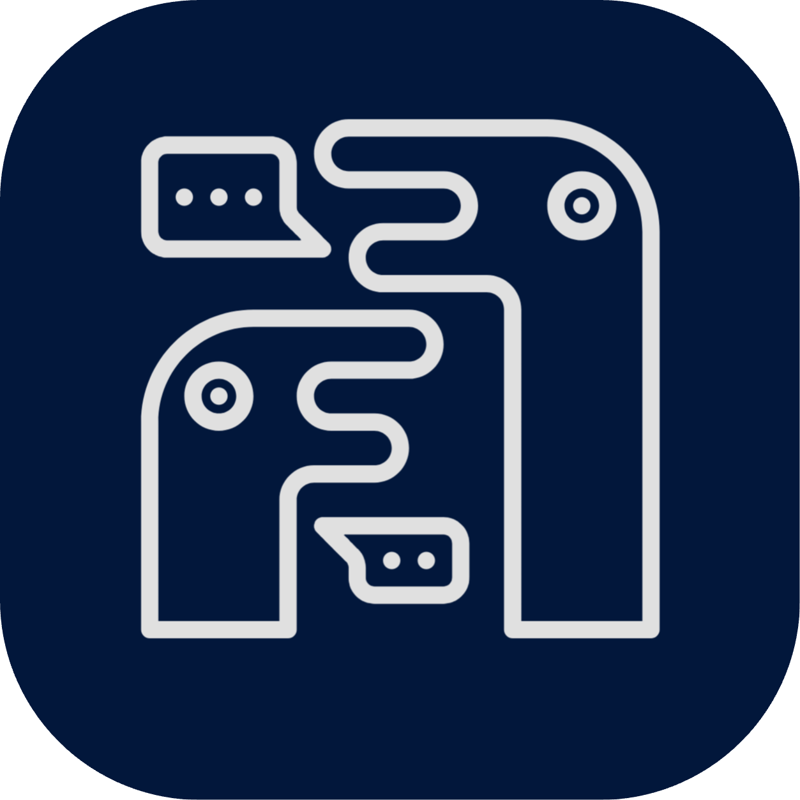
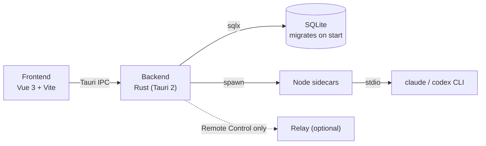

<p align="center">
  
</p>

<h1 align="center">Puppeteer</h1>

<p align="center"><strong>Your AI dev team, on your own machine.</strong></p>

Puppeteer is a local-first desktop app for developers. It runs AI coding agents (Claude and Codex today, more engines later) through the `claude` and `codex` CLIs you are already signed in to, so you need no AI API keys and there is no Puppeteer cloud. One session can act as a **Conductor**: it splits a goal into worker sessions that run in parallel. You keep control of every prompt, permission and account, and your secrets stay in the OS Keychain.

> **Status:** in active development. Puppeteer runs from source on your own machine. There is no official release, installer or license yet. macOS comes first; Windows and Linux will follow once macOS is complete.

## Highlights

Puppeteer is built so you can keep working while the agents run.

- **Work with text while you prompt.** Select text anywhere in a session to **Quote** it into the chat (each quote can carry its own note), **Translate** it, copy it as Markdown, or save it as a **Note** or a **Todo**. While a turn runs, **Queue** your next message or **Steer** the running turn.
- **Track work with a Board and flags.** The Board shows Sessions in columns by flag (Backlog, To Do, In Progress, In Review, Done, plus your own shared or per-project flags). Drag a card to change its flag, and filter History by flag.
- **Windows that never block you.** Every run with a pending request gets its own **Permission** window, even runs in the background or in a pop-out, so switching between many sessions never loses a prompt. Files open as tabs of their session and can pop out into a window pinned on top. **Open windows** (`⌘⇧E` by default) lists every window and moves them back into the main window.
- **File transfer.** Copy files between this computer and a machine you control through Remote Control, with a transfer queue and conflict handling (replace, merge, keep both, skip).

## Features

- **Two engines, one workflow:** Claude and Codex with the same history and permission prompts. Hand a session off to the other engine mid-conversation.
- **Conductor:** multi-agent orchestration with parallel workers. Each worker can get its own git worktree.
- **Agent library:** Skills, Rules, MCP servers, agents and slash commands, applied per project. Includes a built-in Puppeteer MCP server and a code index for agents.
- **GitHub / GitLab:** start runs from issues and PRs, a PR review inbox, and a Gantt view of a project board.
- **History:** mirrors Claude and Codex CLI sessions started outside the app, search across sessions, and rewind file snapshots per turn.
- **Productivity:** notes, todos, focus, calendar, scheduled prompts, Slack threads, and Google (Gmail, Drive, Calendar).
- **Accounts and infrastructure:** several Claude, GitHub, GitLab, AWS, Azure and Google accounts linked per project, plus VPS / SSH servers. A per-run credential broker hands each run only its project's account.
- **Remote control:** pair a phone or another computer through a self-hosted relay with end-to-end encryption.
- **Usage and cost:** token and cost stats, a context meter and a budget guardrail.
- **Security:** secrets kept in the OS Keychain, and an encrypted secret-notes vault.
- **Your choice:** turn off any feature you don't use in **Settings → Features**.

## Architecture



Folder roles are in [Project structure](#project-structure). Relay setup and deployment: [relay/README.md](relay/README.md).

### UI design

The UI is designed with [evondevKit](https://github.com/evondev/evondevKit), which measures and calculates the layout so the app displays well on many kinds of screens, including low-resolution devices and lower-quality panels.

## Requirements

- macOS (Windows and Linux are planned)
- Xcode Command Line Tools
- Rust (stable)
- Node.js 22 or newer
- pnpm 9.15.9 (pinned in `package.json`, enable it with `corepack enable`)
- The `claude` CLI, signed in with your Claude subscription
- The `codex` CLI, signed in with ChatGPT (optional, only for the Codex engine)

## Quick start

```bash
pnpm install                  # frontend + Tauri CLI
npm --prefix sidecar install  # Claude sidecar (npm only, pnpm is blocked)
pnpm dev                      # Vite on localhost:1420 + the Tauri app window
```

The first `pnpm dev` compiles every Rust crate and takes a few minutes. The database is created and migrated on start; there is no `.env` to set up.

For details (database location, reset, relay, common errors), see the run guide: [docs/run-guide.md](docs/run-guide.md) (written in Vietnamese).

## Project structure

```text
.
├── .github/          CI and release workflows
├── docs/             Run guide, design-system preview
├── landing/          Landing page (not hosted yet)
├── public/           Static assets for the frontend
├── relay/            Optional WebSocket relay for Remote Control (standalone Rust crate)
├── remote-e2e/       End-to-end crypto contract for Remote Control (standalone Rust crate)
├── scripts/          Build and i18n helper scripts
├── sidecar/          Claude sidecar (Claude Agent SDK)
├── sidecar-codex/    Codex sidecar, drives codex app-server
├── sidecar-mcp/      Built-in MCP servers (Puppeteer, Google) injected into runs
├── sidecar-proxy/    gh / git / aws / az shims that ask the credential broker for the project's account
├── src/              Frontend: Vue 3, Vite, Pinia, vue-i18n (English / Vietnamese)
├── src-tauri/        Backend: Rust, Tauri 2
│   └── migrations/   SQLite migrations, applied on start
├── index.html        Main app window
├── controller.html   Remote Control web client
├── bridge.html       Remote bridge page
└── package.json      Frontend scripts and dependencies
```

## Contact

- Email: huanvu201203@gmail.com
