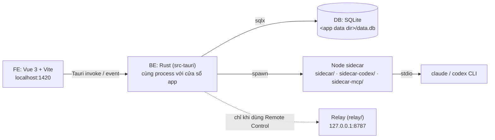

# Hướng dẫn chạy Puppeteer ở máy local (FE + BE + DB)

**Tóm tắt:** Puppeteer là app desktop Tauri. Chỉ cần **một lệnh `pnpm dev`** là chạy đủ cả 3 phần: FE (Vue, Vite ở cổng 1420), BE (Rust, chạy trong chính process của app) và DB (SQLite, một file trên máy, tự migrate khi app khởi động). Không có DB server, không có Docker, không có file `.env` cần tạo.

## 1. Bức tranh tổng thể



| Phần | Code ở đâu | Chạy thế nào |
|---|---|---|
| FE | `src/`, `index.html`, `controller.html`, `bridge.html` | Vite dev server, cổng **1420** (`vite.config.ts`, `strictPort: true`) |
| BE | `src-tauri/` | Tauri tự build và mở cửa sổ app khi chạy `pnpm dev` |
| DB | `src-tauri/migrations/` | File SQLite, BE tự tạo + tự chạy migration lúc khởi động (`src-tauri/src/db.rs:10`) |
| Sidecar | `sidecar/`, `sidecar-codex/`, `sidecar-mcp/`, `sidecar-proxy/` | Script Node, BE tự spawn khi có run. Không cần bật tay |
| Relay (tuỳ chọn) | `relay/` | Crate Rust riêng, chỉ cần khi làm tính năng Remote Control |

## 2. Cài công cụ (làm một lần)

| Công cụ | Phiên bản | Cách cài / kiểm tra |
|---|---|---|
| Xcode Command Line Tools | — | `xcode-select --install` |
| Rust (stable) | stable | `curl --proto '=https' --tlsv1.2 -sSf https://sh.rustup.rs \| sh` rồi `cargo --version` |
| Node.js | **≥ 22** | `node -v` |
| pnpm | **9.15.9** (ghim trong `package.json` → `packageManager`) | `corepack enable` rồi `pnpm -v` |
| `claude` CLI | — | Phải **đăng nhập sẵn** bằng subscription. App không dùng API key |
| `codex` CLI | — | Tuỳ chọn. Chỉ cần nếu muốn chạy engine `codex` |

> Mở terminal mới sau khi cài Rust để `cargo` có trong `PATH`.

## 3. Cài dependency

Chạy ở thư mục gốc repo:

```bash
pnpm install                  # dependency của FE + Tauri CLI
npm --prefix sidecar install  # Claude Agent SDK cho sidecar
```

Lưu ý:

- Sidecar `sidecar/` **bắt buộc dùng npm**, không dùng pnpm. Nó có `"preinstall": "npx only-allow npm"` trong `sidecar/package.json`, nên dùng pnpm sẽ bị chặn.
- `sidecar-codex/`, `sidecar-mcp/`, `sidecar-proxy/` không có dependency, không cần cài gì.
- Rust crate không cần cài riêng, `cargo` tự tải ở lần chạy đầu.

## 4. Chạy app (FE + BE + DB cùng lúc)

```bash
pnpm dev
```

Lệnh này làm theo thứ tự:

1. Chạy `tauri dev` với cấu hình dev (`src-tauri/tauri.dev.conf.json`).
2. Tauri gọi `pnpm dev:vite` (khai báo ở `beforeDevCommand` trong `src-tauri/tauri.conf.json`) → Vite bật ở `http://localhost:1420`.
3. `cargo` build BE. **Lần đầu rất lâu** (vài phút, vì phải compile toàn bộ crate). Các lần sau nhanh hơn nhiều.
4. Cửa sổ **"Puppeteer (dev)"** mở ra. Lúc khởi động, BE tạo file DB (nếu chưa có) và chạy migration.

Khi đang chạy:

- Sửa code trong `src/` → FE tự reload (hot reload).
- Sửa code trong `src-tauri/` → Tauri tự build lại Rust và mở lại cửa sổ.
- Tắt: `Ctrl+C` ở terminal.

### Chỉ chạy FE (không có BE)

```bash
pnpm dev:vite   # mở http://localhost:1420 trên trình duyệt
```

Cách này chỉ hợp để xem layout/CSS. Mình suy đoán là mọi thao tác gọi BE sẽ lỗi, vì ngoài cửa sổ Tauri thì không có backend để `invoke` tới (`src/lib/ipc` chỉ chuyển tiếp lời gọi tới backend local hoặc relay). Muốn test chức năng thật thì dùng `pnpm dev`.

## 5. DB (SQLite)

### File DB nằm ở đâu

BE đặt DB ở `<app data dir>/data.db` (`src-tauri/src/lib.rs:237`). Trên macOS, app data dir của Tauri là `~/Library/Application Support/<identifier>`:

| Chế độ | Identifier | File DB |
|---|---|---|
| Dev (`pnpm dev`) | `io.github.v9n8.puppeteer.dev` | `~/Library/Application Support/io.github.v9n8.puppeteer.dev/data.db` |
| App đã cài (bản build) | `io.github.v9n8.puppeteer` | `~/Library/Application Support/io.github.v9n8.puppeteer/data.db` |

Vì identifier khác nhau nên **dữ liệu dev tách riêng khỏi app thật** đang dùng hằng ngày. Thoải mái thử nghiệm.

> README đang ghi DB ở `~/.puppeteer/data.db`, nhưng code hiện tại dùng app data dir như bảng trên. Sau lần chạy `pnpm dev` đầu tiên, kiểm tra bằng `ls ~/Library/Application\ Support/io.github.v9n8.puppeteer.dev/`.

Log của BE nằm cùng chỗ, trong thư mục `logs/` (`src-tauri/src/lib.rs:223`, file xoay theo ngày `puppeteer.log*`).

### Migration

- Migration nằm ở `src-tauri/migrations/` (hiện có `0001_init.sql`).
- BE tự chạy migration mỗi lần khởi động (`sqlx::migrate!` ở `src-tauri/src/db.rs:10`). Không có lệnh migrate riêng.
- `sqlx::migrate!` nhúng file SQL vào binary lúc compile, nên thêm migration mới xong phải build lại (`pnpm dev` tự làm).
- Muốn đổi schema: **thêm file mới** (ví dụ `0002_xxx.sql`), đừng sửa file migration đã chạy. sqlx lưu checksum của migration đã áp dụng, nên sửa file cũ sẽ làm app báo lỗi lúc khởi động.

### Xem dữ liệu

```bash
sqlite3 ~/Library/Application\ Support/io.github.v9n8.puppeteer.dev/data.db
sqlite> .tables
sqlite> SELECT id, status FROM runs ORDER BY rowid DESC LIMIT 5;
```

Hoặc mở file đó bằng GUI như TablePlus hay DB Browser for SQLite.

### Reset DB dev

Tắt app trước, rồi xoá file DB (cùng file `-wal`/`-shm` nếu có). Lần chạy sau app tạo lại DB trống:

```bash
rm ~/Library/Application\ Support/io.github.v9n8.puppeteer.dev/data.db*
```

> Lệnh này xoá toàn bộ dữ liệu dev (project, run, setting…). Secret như PAT nằm ở Keychain chứ không nằm trong DB, nên không bị xoá theo.

## 6. Relay cho Remote Control (tuỳ chọn)

Chỉ cần khi làm tính năng điều khiển app từ điện thoại hoặc máy khác. Relay là crate Rust độc lập, không thuộc workspace của `src-tauri`.

```bash
cd relay
RELAY_HOST_TOKEN=$(openssl rand -hex 32) cargo run   # mặc định bind 127.0.0.1:8787
```

`RELAY_HOST_TOKEN` là biến bắt buộc, thiếu thì relay không khởi động. Các biến khác và cách deploy lên VPS: xem `relay/README.md` và `relay/deploy/relay.env.example`.

## 7. Kiểm tra code trước khi commit

```bash
pnpm typecheck                     # vue-tsc
pnpm lint                          # eslint (có --fix)
pnpm check:i18n                    # kiểm tra key i18n
(cd src-tauri && cargo test)       # test BE, mỗi test tự tạo SQLite riêng và chạy migration
(cd sidecar && npm run test:mocked) # test sidecar Claude, không gọi API thật
```

## 8. Build bản cài đặt

```bash
pnpm build
```

Lệnh này chạy `pnpm build:vite` (check i18n + typecheck + build FE), build Rust ở chế độ release, rồi `scripts/ensure-sidecar-deps.mjs` kiểm tra dependency của sidecar trước khi đóng gói. Kết quả nằm trong `src-tauri/target/release/bundle/`.

## 9. Lỗi hay gặp

| Triệu chứng | Nguyên nhân | Cách sửa |
|---|---|---|
| `cargo: command not found` / Tauri báo thiếu Rust | Chưa cài Rust, hoặc terminal chưa nhận `PATH` mới | Cài rustup (mục 2), mở terminal mới |
| `Port 1420 is already in use` | Vite đang dùng `strictPort`, có process khác giữ cổng 1420 (thường là lần `pnpm dev` trước chưa tắt hẳn) | `lsof -i :1420` rồi kill process đó |
| Chat báo `Cannot find package '@anthropic-ai/claude-agent-sdk'` | Chưa cài dependency của sidecar | `npm --prefix sidecar install` |
| Run báo không tìm thấy `node` / `claude` / `codex` | BE dò `node` và `PATH` qua login shell của bạn (`src-tauri/src/runs/sidecar.rs`). Nếu shell không load nvm/fnm thì sẽ không thấy | Đảm bảo `node -v` và `which claude` chạy được trong terminal mới |
| App báo lỗi migration khi khởi động | Sửa một file migration đã chạy, hoặc DB dev cũ lệch schema | Revert file migration đã sửa; nếu dữ liệu dev không quan trọng thì reset DB (mục 5) |
| Lần đầu `pnpm dev` lâu | Compile toàn bộ crate Rust | Bình thường, chờ. Lần sau nhanh hơn |
